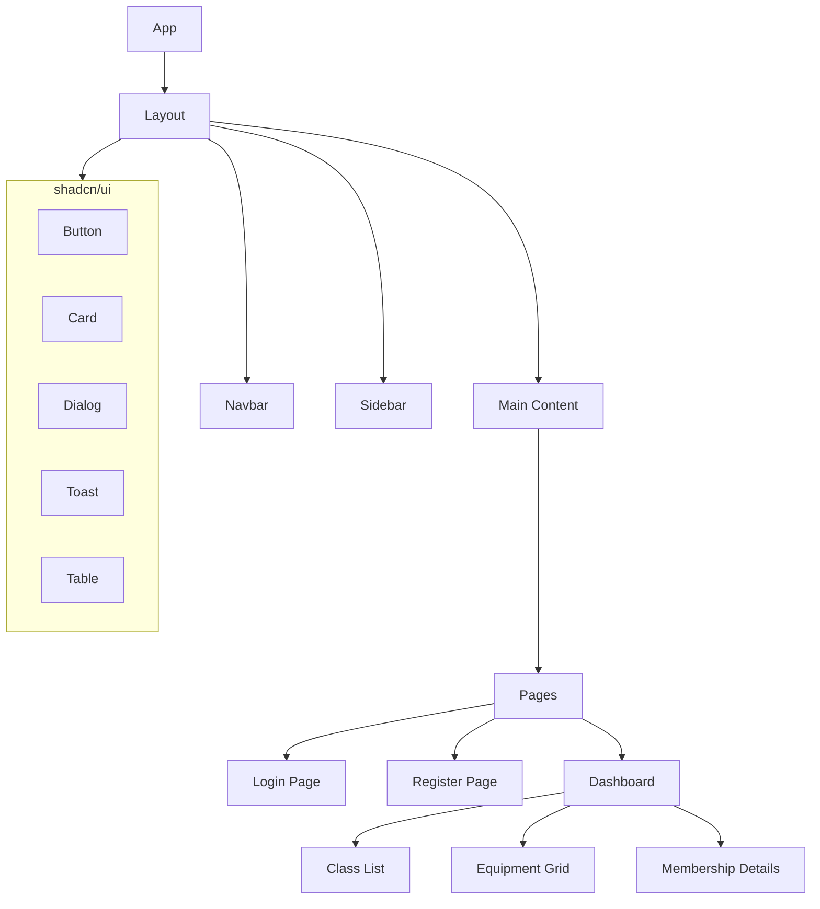

# Gym Journey Hub – Full Project Documentation

## 1. Project Overview & Goals
- **Purpose**: A fitness‑focused web application that helps users discover classes, manage memberships, and track their gym journey.
- **Target Users**: Gym members, trainers, and gym administrators.
- **Core Goals**:
  - Provide a sleek, responsive UI for browsing classes and equipment.
  - Enable seamless authentication and data persistence via Supabase.
  - Support real‑time updates (e.g., class availability) and secure payments.

---

## 2. Architecture Diagram & Technology Stack


- **Frontend**: Next.js (App Router), Typescript, React, Tailwind CSS, shadcn/ui components.
- **Backend**: Supabase (Auth, Postgres DB, Storage, Realtime).
- **Deployment**: Vercel (continuous deployment from GitHub).
- **Styling**: Tailwind + custom CSS variables in `globals.css`.
- **State Management**: React Contexts + custom hooks.
- **Testing**: Jest + React Testing Library (unit), Cypress (e2e).

---

## 3. UI Component Hierarchy



---

## 4. Page & Route Structure (Next.js App Router)
- `app/layout.tsx` – Root layout with global providers.
- `app/login/page.tsx` – Login view.
- `app/register/page.tsx` – Registration view.
- `app/dashboard/page.tsx` – Auth‑protected dashboard.
- `app/classes/page.tsx` – List of gym classes.
- `app/equipment/page.tsx` – Equipment catalogue.
- `app/membership/page.tsx` – Membership management.
- Dynamic routes (e.g., `app/classes/[id]/page.tsx`) for class details.

---

## 5. Key Functions & API Endpoints
### Frontend Utility Functions
#### `src/hooks/use-mobile.tsx`
```tsx
export function useIsMobile(): boolean {
  const [isMobile, setIsMobile] = useState<boolean>(false);
  // logic to detect mobile viewport
  return isMobile;
}
```
*Purpose*: Provides a boolean flag for responsive logic throughout the app.

#### `src/lib/utils.ts`
```ts
export function cn(...inputs: ClassValue[]): string {
  return twMerge(clsx(inputs));
}
```
*Purpose*: Utility to merge Tailwind class strings safely.

#### `src/components/ui/toaster.tsx`
```tsx
export function Toaster() {
  return <Sonner />; // renders toast notifications
}
```
*Purpose*: Centralized toast container used by the `useToast` hook.

### Supabase API Endpoints (via client library)
- `auth.signIn({ email, password })` – User login.
- `auth.signUp({ email, password })` – User registration.
- `from('classes').select('*')` – Fetch class listings.
- `from('equipment').select('*')` – Fetch equipment data.
- `from('memberships').upsert({...})` – Manage membership records.

---

## 6. Data Models & Supabase Schema
| Table | Columns | Description |
|-------|---------|-------------|
| `users` | `id`, `email`, `role` | Authentication & profile data |
| `classes` | `id`, `title`, `description`, `instructor_id`, `schedule`, `capacity` | Gym class catalog |
| `equipment` | `id`, `name`, `type`, `status` | Equipment inventory |
| `memberships` | `id`, `user_id`, `plan_id`, `valid_until` | Membership records |
| `plans` | `id`, `name`, `price`, `duration_months` | Subscription plans |
*Relationships*: `classes.instructor_id → users.id`, `memberships.user_id → users.id`, `memberships.plan_id → plans.id`.

---

## 7. State Management & Contexts
- **AuthContext** (`src/contexts/AuthContext.tsx`): Provides current user & auth helpers.
- **MobileContext** (`src/contexts/MobileContext.tsx`): Wraps `useIsMobile`.
- **ToastContext** (`src/contexts/ToastContext.tsx`): Wrapper around `sonner` for toast notifications.
- **Custom Hooks**: `useIsMobile`, `useToast`, `useSupabaseClient`.

---

## 8. Styling & Design System
- **Tailwind Config** (`tailwind.config.ts`): Custom colors, spacing, and plugins.
- **Design Tokens**: Defined in `src/index.css` with CSS variables for primary, secondary, background, and surface colors.
- **Component Library**: shadcn/ui components (button, card, dialog, toast, table, etc.) extended with our theme.

---

## 9. Deployment & CI/CD Process
1. **Vercel Integration** – GitHub repo linked; automatic deployments on push to `main`.
2. **Environment Variables**:
   - `NEXT_PUBLIC_SUPABASE_URL`
   - `NEXT_PUBLIC_SUPABASE_ANON_KEY`
   - `NEXT_PUBLIC_VERCEL_URL`
3. **Build Command**: `npm run build`
4. **Preview Deployments** for PRs.
5. **Optional CI**: GitHub Actions can run lint, type‑check, and tests on each push.

---

## 10. Testing Overview
- **Unit Tests** (`__tests__/utils.test.ts`): Jest tests for utility functions like `cn`.
- **Component Tests** (`__tests__/Button.test.tsx`): React Testing Library.
- **E2E Tests** (`cypress/`): Cypress scenarios for login flow, class booking, membership management.

---

## 11. Future Roadmap & Open Issues
- Add payment integration (Stripe).
- Implement real‑time class capacity updates via Supabase Realtime.
- Mobile app version using Expo (already in `gym-journey-expo`).
- Improve accessibility (ARIA, keyboard navigation).
- Add unit tests for all custom hooks.

---

*Document generated on 2026‑08‑28.*
